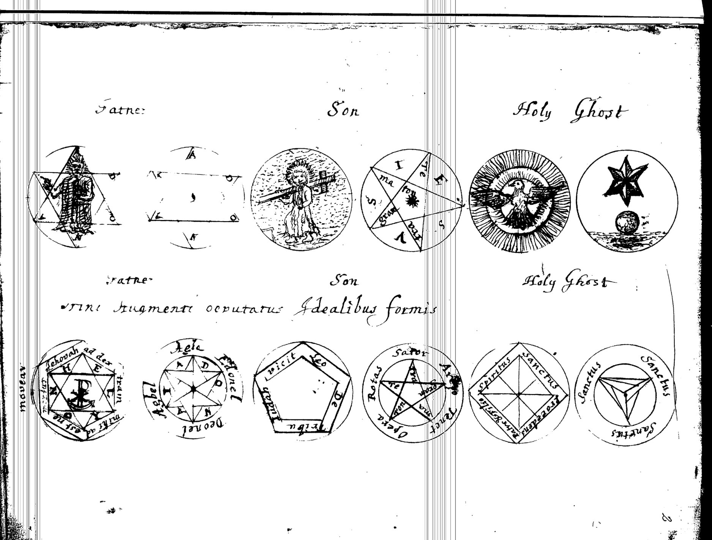
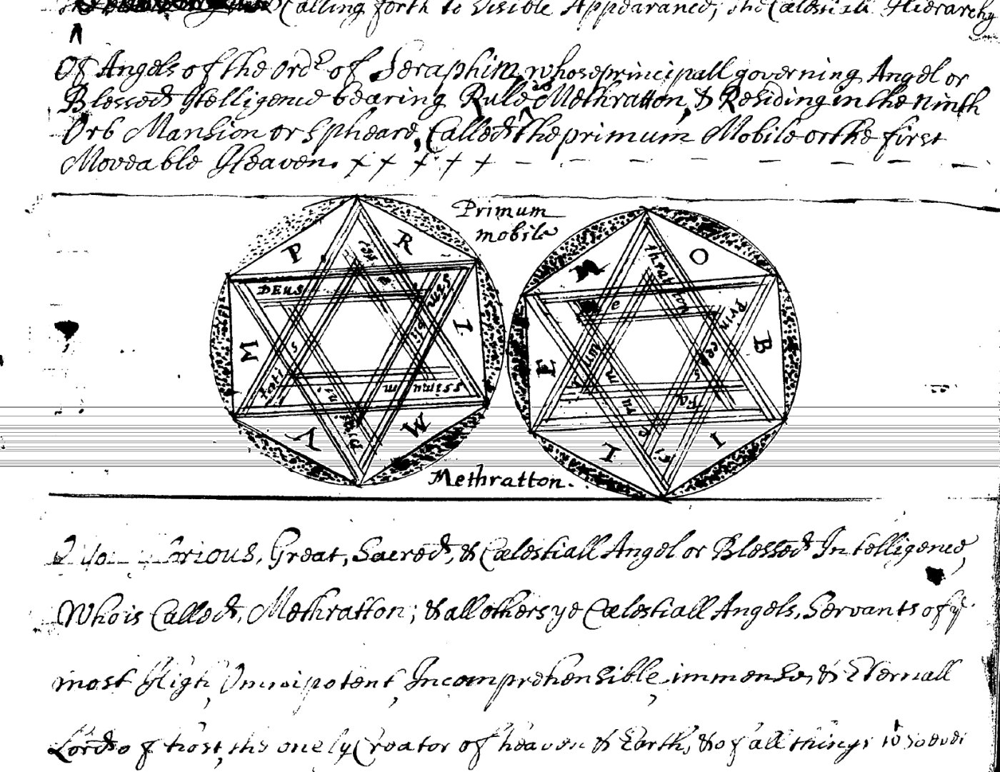
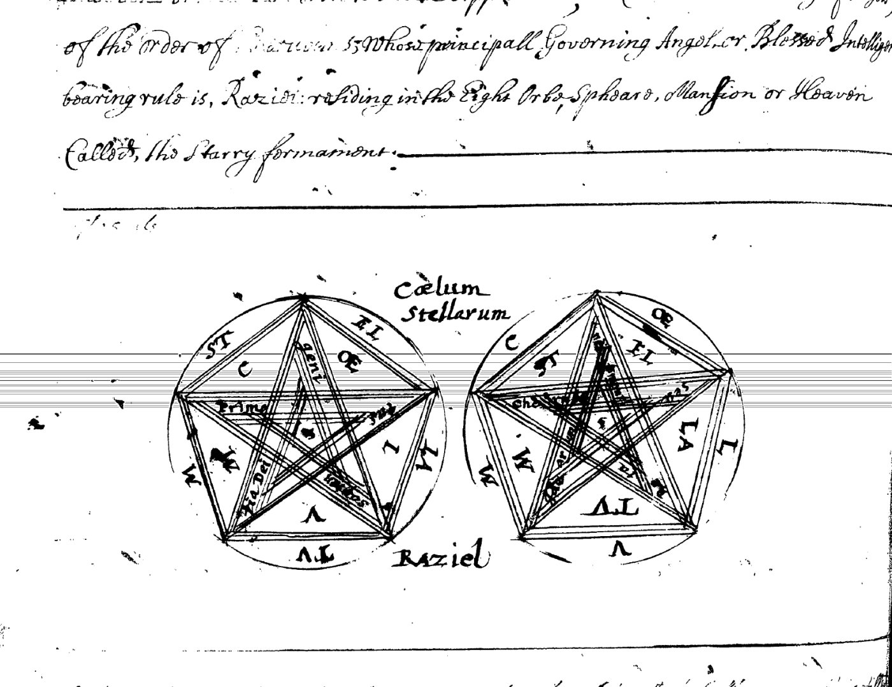
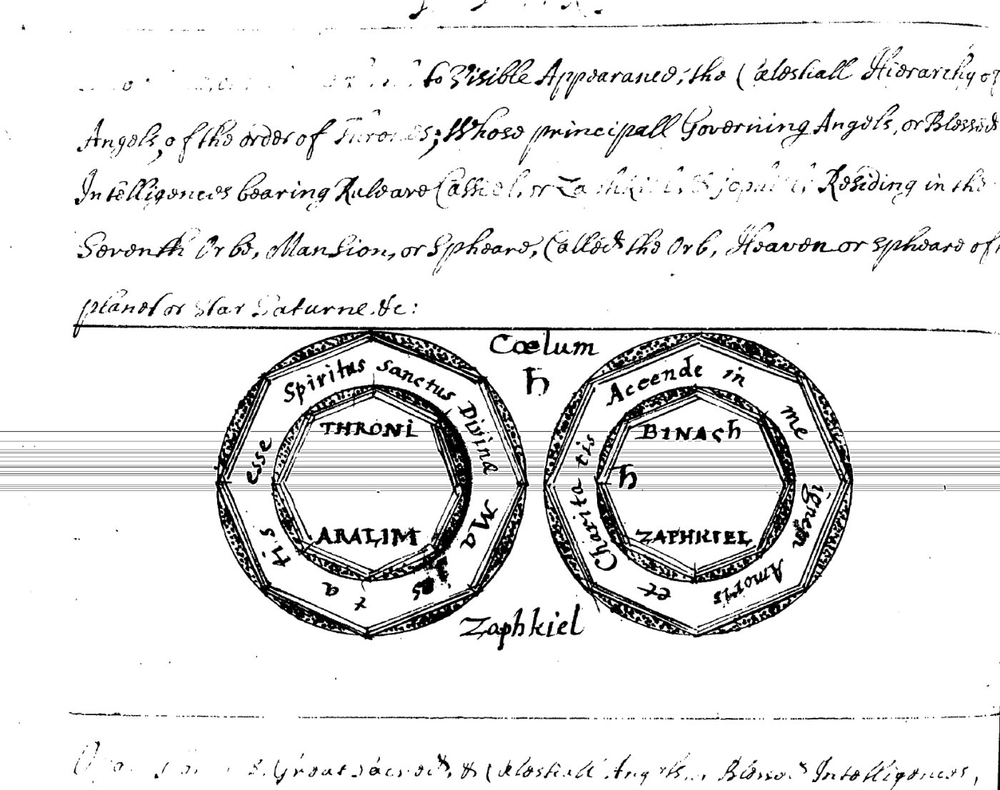
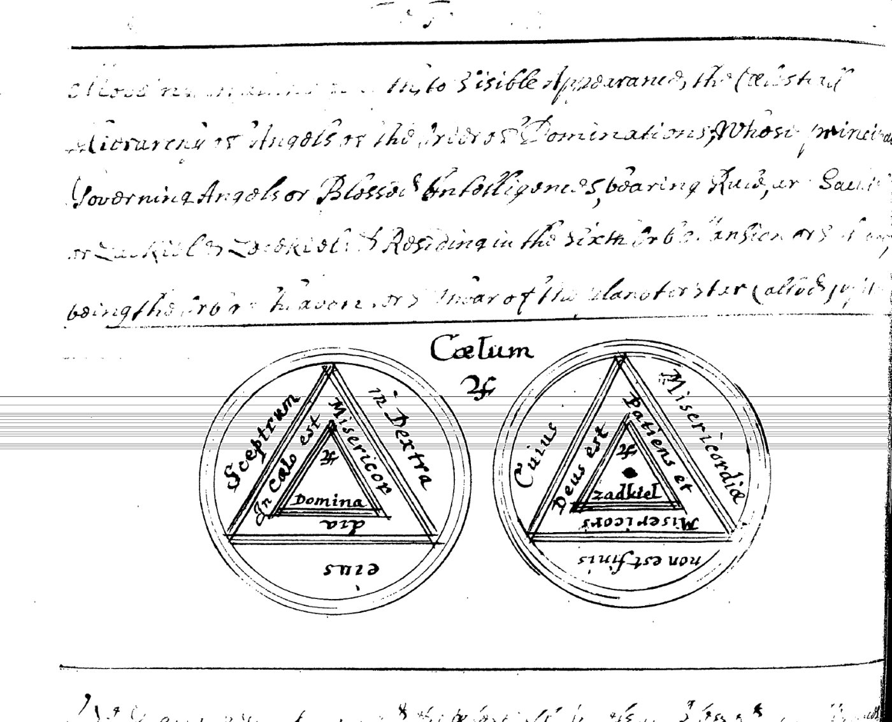
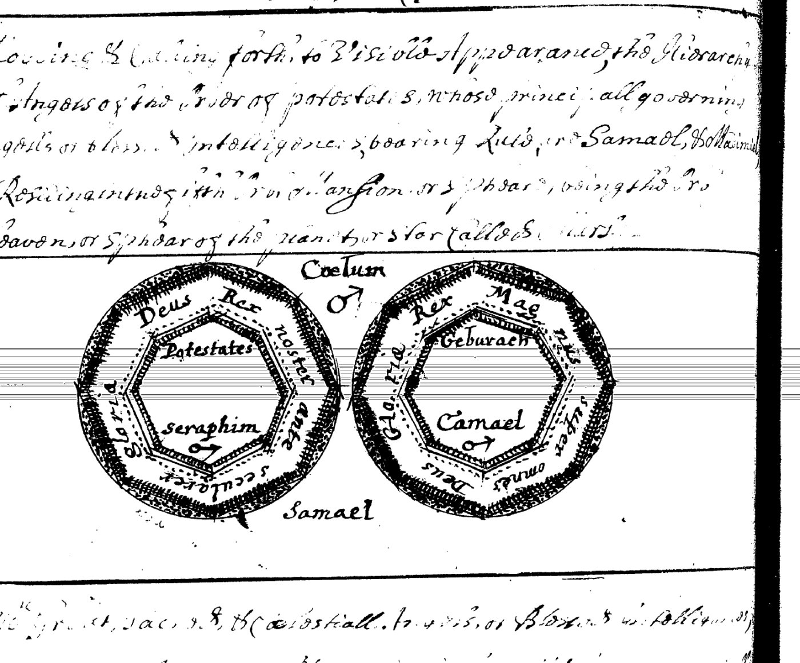
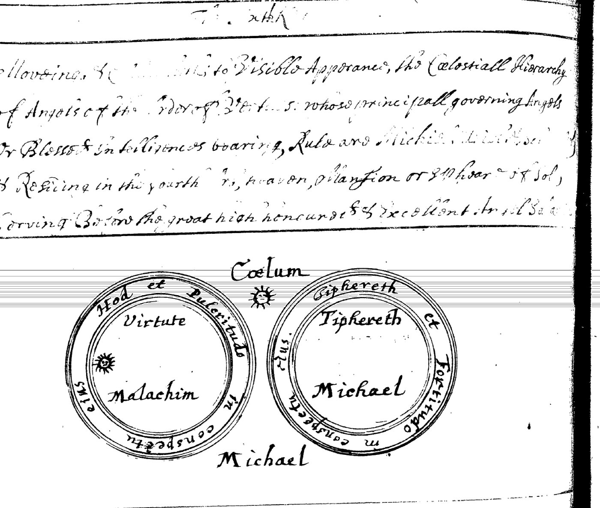
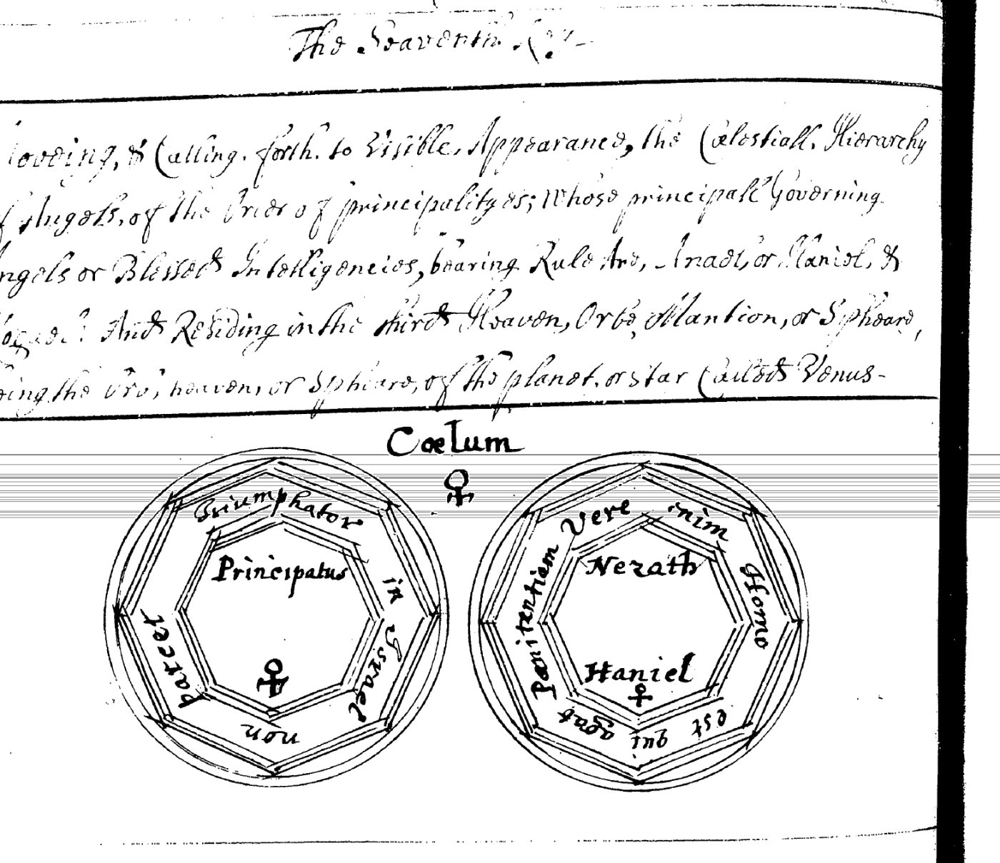
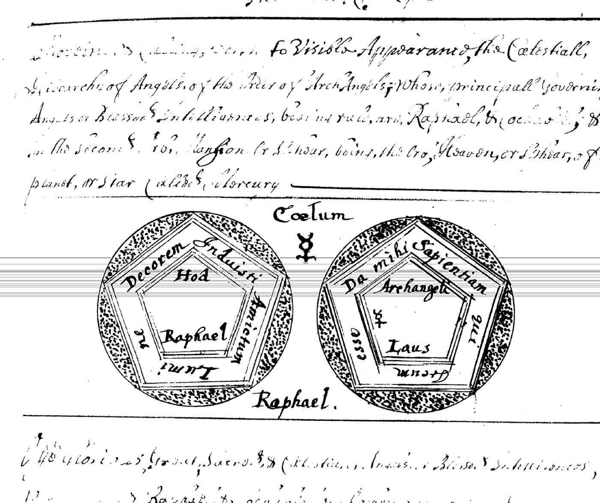
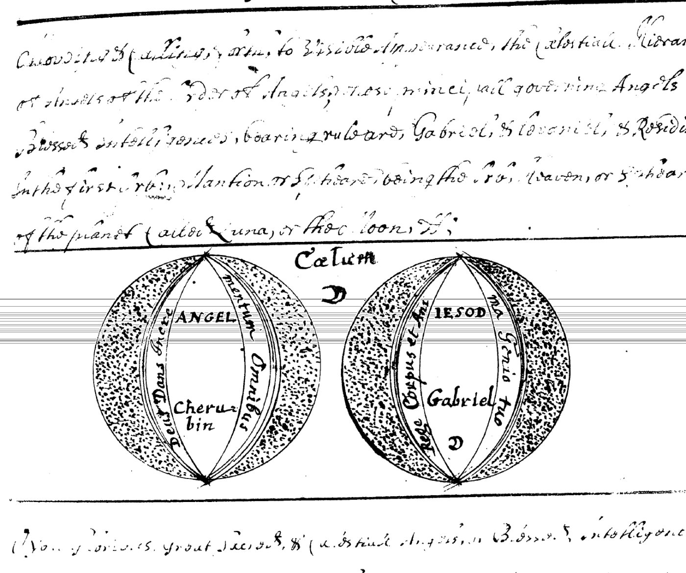

# Sloane MS 3825: the angelic hierarchy

Source study for the angelic layer of Annulus (ANGELICUS). Everything in sections 1–4 is read directly from the manuscript; section 5 is design interpretation and is labelled as such.

## Source

- **Manuscript:** British Library, Sloane MS 3825, a 17th-century English magical compilation. Its opening treatise is the *Janua Magica Reserata*, followed by the angelic invocations described here and later by parts of the *Lemegeton*.
- **Copy used:** British Library Reprographic Section microfilm, published as a 194-frame PDF (`Janua-Magica-Reserata-Sloane-3825.pdf`, via booksofmagick.com).
- **References:** "frame N" means page N of that PDF. Each frame shows one two-page opening of the manuscript.
- **Condition:** the film is high-contrast black and white. Upper parts of most pages are readable; lower parts are often too faded to read.

### Reading conventions

| Mark | Meaning |
|---|---|
| *[…]* | illegible in this scan |
| *(?)* | uncertain reading |
| [square brackets] | word supplied from context, not visible |
| *(inferred)* | not legible; deduced from a pattern stated in the notes |

Spelling inside quotations is the scribe's.

## 1. Frontispiece: the Trinity (frame 8)

Two rows of seals, each row labelled **Father**, **Son** and **Holy Ghost**, two seals per Person. Between the rows is a caption, *"Trini… occultatur Idealibus formis" (?)*, approximately "the Three… is hidden in ideal forms".

| Person | Upper row | Lower row |
|---|---|---|
| Father | a robed figure in a hexagram; a rectangle lettered A–D–O–N–A–I (ADONAI) | a hexagram with a Chi-Rho, ringed *"Jehovah ad dextram mihi… ne movear" (?)*; an eight-pointed star lettered ADONAI, ringed *Agla, Adonel (?), Deonel, Aebel (?)* |
| Son | a figure carrying the cross; a pentagram lettered TE–TRA–GRAM–MA–TON, with I–E–S–V–S around it | a pentagon ringed *"Vicit Leo de tribu Judah"* ("the Lion of the tribe of Judah has prevailed", Revelation 5:5); a pentagram ringed **SATOR AREPO TENET OPERA ROTAS** |
| Holy Ghost | a dove in glory; a six-pointed star over a globe | a square ringed *"Spiritus Sanctus procedens a Patre & Filio" (?)*; a triangle ringed *Sanctus, Sanctus, Sanctus* |

The highest authority appears here only as **names, letters and seals**, never as a figure who acts in the invocations. The prayers that follow address the angels *by* these names.

## 2. The nine Keys

Frames 57–99 hold nine invocations, one for each order of angels. Each opens with a heading of the form

> "…calling forth to visible Appearance, the Cœlestiall Hierarchy of Angels of the Order of *[order]*, whose principall Governing Angel(s) or Blessed Intelligence(s) bearing Rule *[is/are] [names]*, Residing in the *[nth]* Orb, Mansion or Spheare… of the Planet or Star called *[planet]*."

Some sections carry a running title, partly legible, of the form "The Sixth K…", "The Seaventh K…": numbered *Keys*, matching the *Janua*'s gate imagery. *(Reading of "Key" is probable, not certain.)*

The orders run from the highest heaven down to the Moon:

| Key | Order (as written) | Heaven | Governing angel(s) in the heading | Frame |
|---|---|---|---|---|
| 1 | Seraphim | 9th: *Primum Mobile*, "the first Moveable Heaven" | Methratton (Metatron) | 57 |
| 2 | *[Cher]ubims* (?) | 8th: "the Starry firmament" (*Cœlum Stellarum*) | Raziel | 64 |
| 3 | Thrones | 7th: Saturn ♄ | Cassiel, or Zaphkiel, & *Jophiel (?)* | 68 |
| 4 | Dominations | 6th: Jupiter ♃ | Sachiel or Zachiel, & Zedekiel | 73 (repeated at 74) |
| 5 | Potestates (Powers) | 5th: Mars ♂ | Samael, & *Madimiel (?)* | 79 |
| 6 | Virtues | 4th: Sol ☉ | Michael, & *[…]* | 84 |
| 7 | Principalityes | 3rd: Venus ♀ | Anael, or Haniel, & *[…]giel (?)* | 89 |
| 8 | ArchAngels | 2nd: Mercury ☿ | Raphael, & *Cochabiel (?)* | 94 |
| 9 | Angels | 1st: Luna ☽, "the Moon" | Gabriel, & *Levaniel (?)* | 99 |

**Notes on the names:**
- Where a name is legible, the last angel of each heading is formed from the **Hebrew name of the planet** plus *-iel*: Zedekiel (*Tzedek*, Jupiter), Cochabiel (*Kokab*, Mercury), Levaniel (*Levanah*, the Moon), and probably Madimiel (*Madim*, Mars).
  - By the same pattern, the illegible names would be *Shabbathiel* (Saturn), *Shemeshiel* (Sun) and *Nogahel* (Venus). These are *(inferred)* and must not be treated as readings.
- Several angels have more than one name. "Cassiel, or Zaphkiel" and "Sachiel or Zachiel" are given as alternatives for one ruler; "&" joins a second ruler.
- Frames 73 and 74 show the same opening, filmed twice.

## 3. The seals

Every Key carries a **pair of seals**, headed *Cœlum* with the planet's sign: two discs shown side by side. The shape changes with the heaven:

| Key | Shape |
|---|---|
| 1 | hexagram |
| 2 | pentagram |
| 3 | octagon |
| 4 | triangle in triangle |
| 5 | heptagon |
| 6 | plain double circle |
| 7 | octagon |
| 8 | pentagon |
| 9 | lens (vesica) |

On the readable pairs, the **left seal** names the order (its Latin name and/or its Hebrew choir), and the **right seal** names the sephirah and the governing angel. A Latin motto runs around each.

### Key 1: Seraphim, Primum Mobile (frame 57)

- **Left:** letters P–R–I–M–V–M around a hexagram; small inner words, including *DEUS*, not yet fully read.
- **Right:** letters M–O–B–I–L–E around a hexagram; inner words not yet read.
- **Caption:** *Methratton*.

### Key 2: Cherubim, Starry Firmament (frame 64)

- **Two pentagrams:** marginal letters and inner words not yet read. *Prima* and *[…] Dei* are visible on the left.
- **Caption:** *Raziel*.

### Key 3: Thrones, Saturn (frame 68)

- **Left:**
  - Motto: *"Spiritus Sanctus Divinæ Majestatis… esse" (?)*.
  - Centre: **THRONI** / **ARALIM**, the Hebrew choir of the Thrones.
- **Right:**
  - Motto: ***"Accende in me Ignem Amoris et Charitatis"***, "kindle in me the fire of love and charity". It echoes the Pentecost prayer *Veni Sancte Spiritus*.
  - Centre: **BINACH** (Binah) ♄, **ZAPHKIEL**.
- **Caption:** *Zaphkiel*.

### Key 4: Dominations, Jupiter (frames 73–74)

- **Left:**
  - Outer motto: ***"Sceptrum in dextra eius"***, "the sceptre is in his right hand".
  - Inner motto: ***"In cælo est misericordia"***, "in heaven is mercy".
  - Centre: ♃, ***Domina[tiones]***.
- **Right:**
  - Outer motto: ***"Cuius misericordiæ non est finis"***, "of whose mercy there is no end".
  - Inner motto: ***"Deus est patiens et misericors"***, "God is patient and merciful".
  - Centre: ♃, a point, **Zadkiel**.
- The accompanying text binds the angels "by… the name of your God **El**, & by his numerall Attribute ***Hesed (?)***". In the Kabbalah, El is the divine name of Chesed, Mercy, the sephirah of Jupiter, which is the theme of every motto on this seal.

### Key 5: Powers, Mars (frame 79)

- **Left:**
  - Motto: ***"Deus Rex noster ante secula"***, "God our King before the ages" (Psalm 73:12, Vulgate). The word ***Gloria*** stands in the margin.
  - Centre: **Potestates** / **Seraphim** ♂. Seraphim is the Hebrew choir assigned to Geburah in the Kabbalistic scheme, distinct from the Seraphim of Key 1.
- **Right:**
  - Motto: ***"Rex Magnus super omnes Deos"***, "a great King above all gods" (Psalm 94:3, Vulgate), with ***Gloria***.
  - Centre: **Geburach** (Geburah), **Camael** ♂.
- **Caption:** *Samael*.

### Key 6: Virtues, Sun (frame 84)

- **Left:**
  - Motto: ***"Hod et Pulcritudo in conspectu eius"***, "splendour and beauty before him".
  - Centre: ***Virtute[s]*** ☉, **Malachim**.
- **Right:**
  - Motto: ***"Tiphereth et Fortitudo in conspectu eius"***, "beauty and strength before him".
  - Centre: **Tiphereth**, **Michael**.
- The two mottos together are Psalm 96:6 (Hebrew numbering), *hod ve-hadar lefanav, oz ve-tif'eret be-mikdasho*, with the Hebrew words *Hod* and *Tiphereth* left untranslated.
- **Caption:** *Michael*.

### Key 7: Principalities, Venus (frame 89)

- **Left:**
  - Motto: ***"Triumphator in Israel non parcet"***, "the Victor of Israel will not spare".
  - Centre: **Principatus** ♀.
- **Right:**
  - Motto: ***"[Neque e]nim Homo est qui agat Pœnitentiam" (?)***, "for he is not a man, that he should repent".
  - Centre: **Nezach** (Netzach), **Haniel** ♀.
- The two halves are one verse: 1 Samuel 15:29 (Vulgate 1 Kings 15:29).

### Key 8: Archangels, Mercury (frame 94)

- **Left:**
  - Motto: ***"Decorem induisti, amictum lumine"***, "thou hast put on beauty, clothed with light" (Psalm 103:1–2, Vulgate).
  - Centre: **Hod**, **Raphael**.
- **Right:**
  - Motto: ***"Da mihi Sapientiam…" (?)***, "give me wisdom…"; the remaining words (*qui… circum… esse*) are not yet read.
  - Centre: **Archangeli** ☿, ***Laus (?)***.
- **Caption:** *Raphael*.

### Key 9: Angels, Moon (frame 99)

- **Left:**
  - Motto: ***"Deus Dans Incrementum Omnibus"***, "God, who gives increase to all" (compare 1 Corinthians 3:7).
  - Centre: **ANGEL[I]** / **Cherubin**, the Hebrew choir assigned to Yesod.
- **Right:**
  - Motto: ***"Rege Corpus et Animam… Genio tuo" (?)***, approximately "rule body and soul… by thy genius"; uncertain.
  - Centre: **IESOD** (Yesod), **Gabriel** ☽.

### Pattern across the Keys

| Key | Order | Hebrew choir on seal | Sephirah on seal | Angel on seal |
|---|---|---|---|---|
| 3 | Thrones | Aralim | Binah | Zaphkiel |
| 4 | Dominations | — | (Chesed, in the text) | Zadkiel |
| 5 | Powers | Seraphim | Geburah | Camael |
| 6 | Virtues | Malachim | Tiphereth | Michael |
| 7 | Principalities | — | Netzach | Haniel |
| 8 | Archangels | — | Hod | Raphael |
| 9 | Angels | Cherubin | Yesod | Gabriel |

**The angel on the seal sometimes differs from the first ruler in the heading.** For Mars, the heading names Samael but the seal names Camael; for Saturn, the heading names Cassiel first but the seal names Zaphkiel. The manuscript treats these as alternate names or co-rulers, not contradictions.

## 4. The form of an invocation (frames 74–76, Key 4)

The Dominations invocation is the most legible and shows the structure every Key follows:

1. **Address.** The angels are named, with their order, heaven and planet.
2. **Binding names.** "By the seales of his own Omnipotent great & holy name *Adonai (?)*… And by the seale of *your (?)* Creation, being the Marke or Character of holynesse unto you."
3. **Chain of authority.** Power descends "by severall Emanations… from the Superiour to the Inferiour"; the angels serve "the divine services, commands & appointments of the most highest, in the order & office of Dominations"; each acts "according to your generall & respective offices".
4. **Divine name and attribute.** "By… the name of your God **El**, & by his numerall Attribute *Hesed (?)*."
5. **Sign before appearance.** "To shew plainly & visibly unto us a foregoing signe or token of your Appearance."
6. **Communion requested.** "Angelicall Benevolence, Cœlestiall Illumination, favourable Assistance, familiar Society, mutuall Correspondency, verball Converse, continuall Community & sacred Instructions."
7. **Need for mediation.** Without the angels it is "very difficult if not impossible for us or any Mortall on earth to find or obtaine, or to be esteemed worthy of enterance into, with Testimony."

## 5. Design notes for Annulus *(interpretation, not history)*

| Manuscript element | Possible role in Annulus |
|---|---|
| The Trinity shown only through names and seals (frame 8) | THE ABSOLUTE is never an object: programs refer to it only by name and seal, never hold or call it |
| Nine Keys, one per order and heaven | the typed hierarchy of ANGELICUS: order, heaven, planet, sephirah, choir, rulers |
| Divine name and attribute per heaven (El / Hesed) | the root of every ORIGIN chain |
| "From the Superiour to the Inferiour" | authority can only be derived downward: *nulla potestas a se ipsa oritur* |
| Several names for one angel; "or" versus "&" | an identity with aliases (IDENTITAS), distinct from co-rulers |
| Two-sided seals: order on the left, individual on the right | an order-level seal and a personal seal: authority of the office versus identity of the officer |
| "Generall & respective offices" | each angel holds its order's office plus its own (OFFICIUM) |
| Sign or token before the appearance | a manifestation announces a checkable token before any effect (EXAMINATIO) |
| Entry "with Testimony" | access is granted on attestation, never claimed |
| The forms of communion | the record types of REVELATIO |

## 6. Elsewhere in this scan (for later study)

- **Frames ~109–119:** the *Goetia* as copied in Sloane 3825: Amon, Barbatos, Paimon, Buer, Gusion, Sitri, Beleth and onwards, each with its seal drawn in the text. The seals here are **bare sigils, without the lettered double ring** of the 1904 edition. This is the oldest available witness for the seven spirits printed twice in 1904.
- **Frames 120–123:** circle, hexagram, pentagram and the Vessel of Brass.
- **Frames 126–153:** a compass diagram and many pages of spirit seals, probably the *Theurgia-Goetia* and later parts of the *Lemegeton*.
- **Frame 155:** a squared diagram, not yet identified.

## Open items

- Read the remaining mottos and small inner words: Keys 1, 2, 8 (right), 9 (right) and 3 (left).
- Read the second ruler names for Keys 3, 6 and 7.
- Confirm the "Key" running titles.
- Compare with parallel copies (Sloane 3824, Harley 6482) and published transcriptions, once the deferred research is done.
